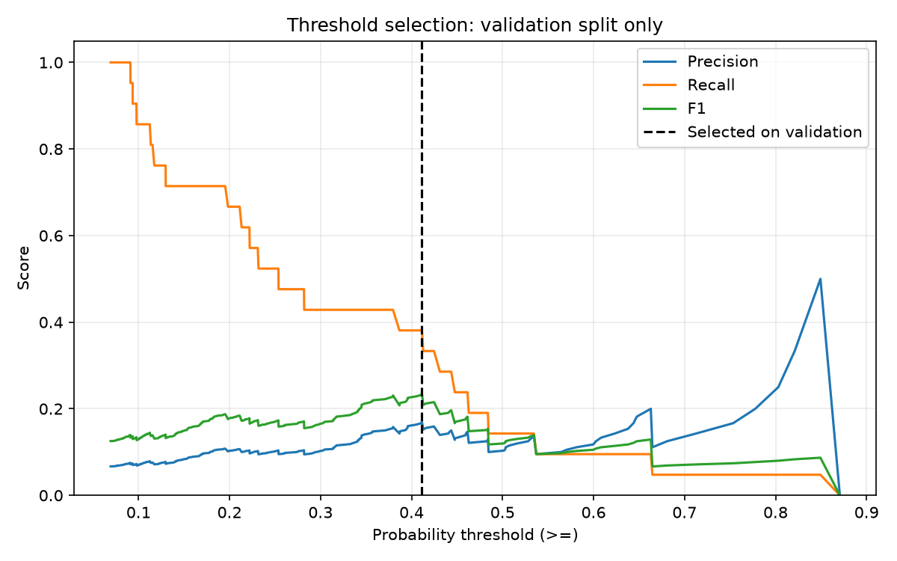
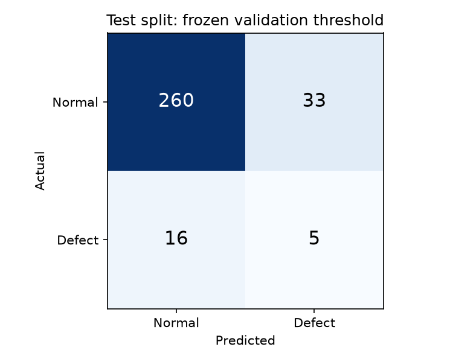

# 반도체 수율·불량률 분석

[공식 UCI SECOM 데이터](https://archive.ics.uci.edu/dataset/179/secom)로 수율·불량률을 계산하고 XGBoost 불량 예측 모델을 평가합니다. 전처리와 모델 선택은 학습 데이터에서, 판정 임계값 선택은 별도의 검증 데이터에서 수행합니다.

## 데이터

| 항목 | 값 |
|---|---:|
| 샘플 수 | 1,567 |
| 센서 수 | 590 |
| 정상 / 불량 | 1,463 / 104 |
| 수율 | 93.3631% |
| 불량률 | 6.6369% |

공식 ZIP을 처음 실행할 때 내려받고 `data/secom.zip`에 캐시합니다. 다운로드와 기존 캐시 모두 고정된 SHA-256을 검사합니다. 원본 라벨 -1을 정상 0으로, 불량 1을 불량 1로 사용합니다. 시간 정보는 보존하되 모델 특성에서는 제외합니다. 원본 데이터는 Git에 포함하지 않습니다.

## 실행

Python **3.12**에서 검증했습니다. 저장소 루트에서 다음 명령을 실행합니다.

```bash
python3.12 -m venv .venv
source .venv/bin/activate
python -m pip install -r requirements.txt
python -m ipykernel install --sys-prefix --name python3 --display-name "SECOM (Python 3.12)"
python -m jupyterlab
```

Windows PowerShell에서는 `py -3.12 -m venv .venv`와 `.venv\Scripts\Activate.ps1`을 사용하고, 이후 `python -m ...` 명령은 동일하게 실행합니다. Linux x86_64는 CPU 전용 XGBoost를, 다른 플랫폼은 표준 XGBoost를 설치합니다. 다른 플랫폼의 실행은 별도로 검증하지 않았습니다.

[`secom_yield_analysis.ipynb`](secom_yield_analysis.ipynb)를 열어 위에서부터 모두 실행하세요. 동일한 분석을 명령줄에서도 실행할 수 있습니다.

```bash
python secom_analysis.py --jobs 2 --output-dir results
python -m unittest discover -s tests -v
```

`SECOM_DATA_DIR` 환경변수 또는 CLI의 `--data-dir`으로 캐시 위치를 지정할 수 있습니다. 다운로드에는 `archive.ics.uci.edu` 접근이 필요합니다. 노트북은 실행 도중 패키지를 설치하지 않습니다. 주요 패키지의 검증된 버전은 [`requirements.txt`](requirements.txt)에 고정되어 있습니다.

## 분석 절차

1. **전처리 전에 분할:** seed=42로 계층화하여 학습 939건(불량 62), 검증 314건(불량 21), 테스트 314건(불량 21)으로 나눕니다. 먼저 테스트 20%를 분리하고 남은 데이터의 25%를 검증용으로 사용합니다.
2. **각 학습 fold 안에서 전처리:** 결측률 40% 초과 센서 제거 → 중앙값 대체 → 분산 0.05 이하 센서 제거 → 표준화 → SMOTE → XGBoost. 결측률 필터, 중앙값, 변수 선택과 스케일러를 모두 파이프라인에 넣었습니다. SMOTE의 이웃 거리를 계산하기 전에 표준화하고, 예측에는 SMOTE를 적용하지 않습니다.
3. **학습 데이터로 모델 선택:** 셔플을 고정한 3-fold CV에서 평균 정밀도(AP)를 최대화합니다. max_depth=[3,5,7], learning_rate=[0.01,0.1,0.2], n_estimators=[50,100,200]의 **27개 조합, 81회 CV 학습**입니다. 불균형 보정에는 SMOTE를 사용하며 `scale_pos_weight=1`로 고정합니다.
4. **검증 데이터로 임계값 선택:** 학습 분할로 재학습한 최적 모델의 검증 확률에서 불량 F1을 최대화합니다. F1이 정확히 같으면 높은 임계값을 고릅니다. 판정은 `확률 >= 임계값`이며, PR 곡선 마지막 점에는 대응 임계값이 없으므로 선택에서 제외합니다.
5. **고정된 모델·임계값으로 테스트:** 임계값 선택 후 모델을 다시 학습하지 않습니다. 기본 0.5와 검증에서 선택한 임계값의 결과를 함께 보고하되 테스트 결과로 둘 중 하나를 재선택하지 않습니다. 모든 예측에는 원본 센서 값을 전달합니다.

## 재실행 결과

실제 UCI 데이터를 사용한 2026-11-01 17:35 KST 실행 결과입니다. 노트북 전체 실행과 회귀 테스트 **15개가 통과**했습니다. 81회 CV 학습 후 최적 모델을 학습 분할에 한 번 재학습했으며, 전체 노트북 실행은 약 135초였습니다(환경에 따라 달라집니다).

- 최적 모델: `max_depth=5`, `learning_rate=0.01`, `n_estimators=200`.
- 최고 학습 CV AP: **0.2446**.
- 학습 분할에서 결측률 필터 후 558개, 분산 필터 후 264개 센서 선택.
- 선택 임계값: **0.41138148307800293**, 판정 규칙 `확률 >= 임계값`.
- 검증 데이터의 불량 정밀도 **0.1702**, 재현율 **0.3810**, F1 **0.2353**.
- 테스트 AP: **0.1270**, ROC-AUC: **0.6875**.

아래 표는 **테스트 데이터의 불량 클래스** 결과입니다.

| 판정 방식 | 임계값(표시용 반올림) | 정밀도 | 재현율 | F1 | 탐지한 불량 | 정상 오탐 |
|---|---:|---:|---:|---:|---:|---:|
| 기본 임계값 | 0.500000000 | 0.1905 | 0.1905 | 0.1905 | 4 / 21 | 17 |
| 검증 F1 선택 | 0.411381483 | 0.1316 | 0.2381 | 0.1695 | 5 / 21 | 33 |

검증에서 선택한 임계값은 테스트에서 불량 1건을 더 탐지했지만, 오탐이 늘어 기본 0.5보다 F1이 낮았습니다. 검증 F1 최적화가 테스트 F1 개선을 보장하지 않는 사례이며, 이 결과를 보고 임계값을 다시 고르지 않았습니다. 이전 분석과는 학습 크기·평가 절차·선택 기준이 달라 단순 성능 향상으로 비교하지 않습니다.






## 수정한 문제

| 이전 분석의 문제 | 현재 동작 |
|---|---|
| 전체 데이터로 결측치 대체·변수 선택 후 분할 | 분할 후, CV의 각 학습 fold에만 전처리 적합 |
| SMOTE 이후 표준화 | 표준화 후 SMOTE로 센서 척도가 이웃 선택을 지배하지 않도록 처리 |
| 스케일러가 포함된 모델에 이미 변환한 입력 전달 | 파이프라인에 원본 입력을 전달해 이중 스케일링 제거 |
| 테스트 라벨로 임계값 선택 | 별도 검증 분할의 F1으로 선택 후 고정 |
| README의 0.418 표기에 0.3 결과를 사용 | 이번 실행의 정확한 임계값·판정 규칙·수치를 함께 기록 |
| 개인 Windows 절대 경로와 셀 안의 무버전 pip 설치 | 공식 데이터 다운로드·해시 검증, 상대 경로와 의존성 파일 제공 |

이전 셀의 불량 재현율 0은 이중 스케일링 오류의 영향을 받았습니다. 이를 기본 임계값 0.5만의 문제로 해석하던 설명을 삭제했습니다. 과거 성능 수치를 현재 결과로 재사용하지 않습니다.

## 해석상 한계

- **기존 테스트 열람 이력:** seed=42의 테스트 분할은 이전의 잘못된 분석에서도 살펴본 데이터입니다. 현재 실행 코드는 테스트를 학습이나 임계값 선택에 사용하지 않지만, 이 결과는 새 외부 데이터에 대한 독립 검증이 아닙니다.
- **적은 불량 표본:** 검증·테스트에 불량이 각각 21건뿐이므로 한 건의 차이가 재현율을 약 4.76%p 바꿉니다. 단일 분할의 수치나 선택 임계값이 안정적이라고 단정하지 않습니다.
- **시간·배치 변화 미검증:** 무작위 계층화 분할은 향후 생산 시점의 성능이나 공정·배치 변화에 대한 일반화를 보장하지 않습니다.
- **비용 최적화 아님:** 검증 F1 최대화는 명확한 선택 기준이지만, 실제 불량 누락과 정상 오탐의 비용을 반영한 사업상 최적 임계값은 아닙니다.
- **전처리 기준:** 분산 0.05는 원래 센서 단위에 의존하는 고정 기준입니다. 모든 센서나 다른 공정에 일반적으로 최적이라고 주장하지 않습니다.

실제 적용 여부는 별도 시점·배치의 데이터, 충분한 불량 표본, 업무 비용을 반영한 기준으로 추가 평가해야 합니다.

## 파일과 검증

- [`secom_analysis.py`](secom_analysis.py): 데이터 로딩, 전처리·모델 파이프라인, 분할, 임계값 선택 및 실행.
- [`secom_yield_analysis.ipynb`](secom_yield_analysis.ipynb): 같은 모듈을 사용하는 실행 완료 노트북.
- [`results/metrics.json`](results/metrics.json): 분할, 선택 기준, 파라미터, 지표와 패키지 버전.
- [`results/grid_search_results.csv`](results/grid_search_results.csv): 전체 교차검증 결과.
- [`results/validation_predictions.csv`](results/validation_predictions.csv), [`results/test_predictions.csv`](results/test_predictions.csv): 원본 행 번호·시각·확률·판정.
- [`tests/test_analysis.py`](tests/test_analysis.py): fold별 전처리 통계, 분할의 배타성, 원본 입력 예측, 임계값 선택·경계, CSV 확률 정밀도, 데이터 무결성 회귀 테스트.

테스트는 실제 데이터 다운로드 없이 실행되며, 작은 실제 XGBoost 학습도 포함합니다. 전체 분석은 별도로 공식 SECOM 데이터로 실행해 검증합니다.

### 예측 CSV를 다시 검증할 때

모델의 확률은 float32이므로, CSV에는 float64로 확장한 뒤 유효 숫자 17자리로 저장해 원래 값을 보존합니다. pandas의 기본 소수 파서는 최하위 비트를 반올림할 수 있으므로, JSON의 정확한 임계값과 다시 비교할 때는 `float_precision="round_trip"`을 사용하세요.

```python
import json
import numpy as np
import pandas as pd
from pathlib import Path

metrics = json.loads(Path("results/metrics.json").read_text())
threshold = metrics["threshold_selection"]["threshold"]
for split in ("validation", "test"):
    predictions = pd.read_csv(
        f"results/{split}_predictions.csv", float_precision="round_trip"
    )
    np.testing.assert_array_equal(
        (predictions["probability_defect"] >= threshold).astype(int),
        predictions["prediction"],
    )
```

## 추가 모델 성능 비교 작업

별도 브랜치에서 다섯 모델의 중첩 교차검증 실험을 준비했습니다. **실제 데이터 다운로드가 현재 환경의 네트워크 정책으로 차단되어 새 성능 결과와 최종 모델은 아직 없습니다.** 기존 결과와 실행 흐름은 보존했습니다. 비교 절차, 실행 방법과 진행 상태는 [experiments/README.md](experiments/README.md)를 참고하세요.
